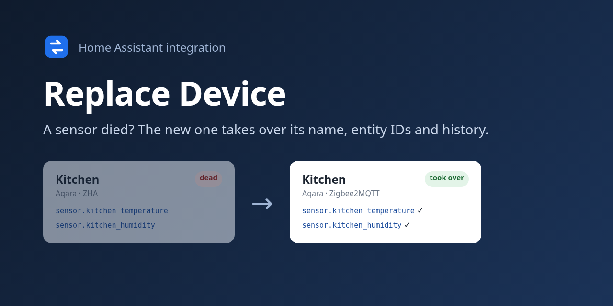
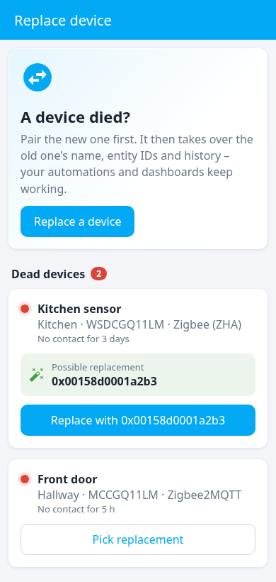
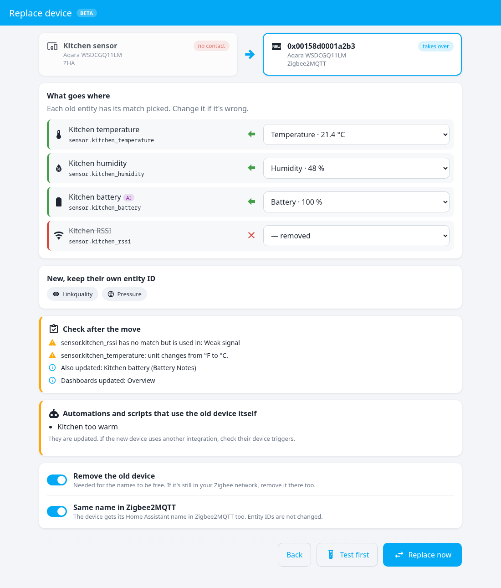
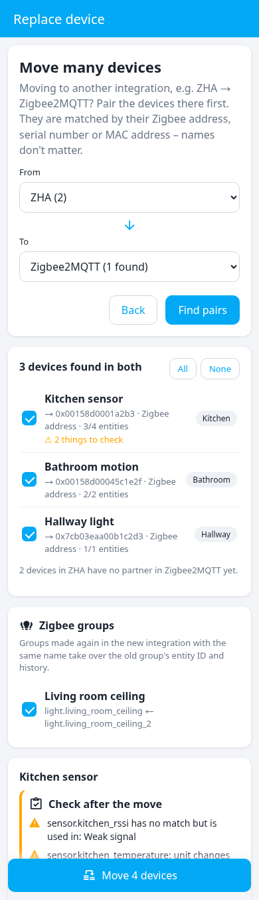

# Replace Device

**A sensor died? Pair the new one – it takes over the old one's name, entity IDs and history. Your automations and dashboards keep working.**

[English](#english) · [Dansk](#dansk)

## English

When a device breaks and you buy a new one, Home Assistant sees a stranger: new entity IDs, no history, and every automation, script and dashboard still points at the dead one. Replace Device moves everything over in one go – for one device, or for a whole network moving from ZHA to Zigbee2MQTT.

 

### What moves over

| | |
| --- | --- |
| **Entity IDs** | The new entities get the old IDs, so automations, scripts, scenes, dashboards and templates keep working. |
| **History and statistics** | Graphs and long-term statistics continue. Energy totals too – a new meter starting at 0 kWh is handled as a reset. |
| **Your settings** | Names, icons, areas, labels, categories, voice aliases, display precision and unit settings. |
| **The device** | The new device gets the old one's name and area – also in Zigbee2MQTT, if you want. |
| **Automations and scripts** | Everything that points at the old device by ID: `automations.yaml`, `scripts.yaml`, `scenes.yaml` and `packages/`. |
| **Button triggers** | Triggers with other names in the new integration are translated (ZHA `remote_button_short_press` → Zigbee2MQTT `action: single`), and so are `zha_event` triggers and Zigbee2MQTT MQTT topics. |
| **Blueprints** | Inputs meant for the old integration are moved to the right ones – e.g. a "ZHA / Zigbee2MQTT" remote blueprint gets the Zigbee2MQTT name and base topic instead of the ZHA device. |
| **Dashboards and other integrations** | Dashboards made in the UI, and integrations that store the device (e.g. Battery Notes). |
| **Zigbee groups** | Make the group again in the new integration with the same name, and it takes over the old group's entity ID and history. |

A note is added to the logbook, and if the new device sends no values after 10 minutes, you get a repair.

### Before you replace: what could still bite

The preview lists what it can't fix by itself, so nothing comes as a surprise:

- Entities only the old device had, and where they are used
- Values the new one doesn't have (e.g. `On` vs `on` in a select)
- Unit changes – shown in red for energy, because Wh → kWh breaks the energy statistics
- Device actions of the old integration (e.g. a ZHA LED effect)
- Code outside Home Assistant (AppDaemon, Node-RED, pyscript …) that mentions the old device – only when it is found

### It notices by itself

Pair a new device of the same make and model while an old one has been dead for an hour, and a repair shows up: **"New Aqara WSDCGQ11LM found – replace Kitchen?"**. Tap **Fix**, check the preview, done.

### Move many devices at once

Moving from **ZHA to Zigbee2MQTT** (or any integration to another)? Pair the devices in the new integration, then tap **Move many devices** in the panel and pick *from* and *to*. Every device found in both is paired by what doesn't change: the **Zigbee address** (IEEE), the **serial number** (Matter) or the **MAC address** (Wi-Fi). Names don't matter. Untick the ones to leave, and move them all with one tap.

### Optional AI help

Connect any AI Task entity (e.g. Google Gemini, free) under **Settings → Devices & services → Replace Device → Configure**. It is only asked when something can't be matched by itself: entities named differently on the old and the new device ("Analog input" ↔ "Local temperature"), and button triggers with no obvious twin. Suggestions are marked **AI** in the panel, and you can change them. Tip: give it its own free Gemini key in its own project, so it doesn't share the daily quota.

### Installation

1. **HACS** → ⋮ → **Custom repositories** → `https://github.com/Clahen86/ha-replace-device`, type **Integration** → **Add**.
2. Search for **Replace Device** → **Download**, and restart Home Assistant.
3. **Settings → Devices & services → Add integration → Replace Device → Submit.**

### How to replace a device

1. Pair the new device as you normally would.
2. Open **Replace device** in the sidebar. Dead devices are listed, with a likely replacement when one is found – tap **Replace with …**. Or tap **Replace a device**, search for the old one, then the new one. The same physical device or the same model is shown first.
3. The old and the new device are shown side by side. Each old entity has its match picked (temperature to temperature, battery to battery). Change one if it's wrong, or pick "— removed".
4. Read what to check, then tap **Replace now**.

Got two names mixed up (temperature and humidity, say)? Tap **Change** next to the replacement under *Replaced* and move the names to the right entities. Only names change – the device stays where it is.

The same is available without the panel: **Settings → Devices & services → Replace Device → Replace a device**.

### Good to know

- The old device is removed, so its names are free. If its integration doesn't allow that (a device that is still connected), you're told to remove it there. If it is still in your Zigbee network, remove it there too.
- Dead devices are found by being unavailable for an hour. In Zigbee2MQTT that needs **availability** turned on (Settings → Availability); without it, a dead device keeps its last value.
- If one step fails (a broken dashboard, a file it can't read), the rest still runs and the replacement can still be undone; the log says what was skipped.
- A replacement can't move a device back to its old integration – that takes pairing it there again (and then a new replacement the other way). Under **Change** you can give the new device its own names back, but the old device doesn't return and automations using the old names stop working, so you're warned first. **Do again** redoes it.
- Not moved: Zigbee bindings (a remote bound directly to a bulb) and calibration set in ZHA or Zigbee2MQTT. Code outside Home Assistant is only reported, not changed.
- Everything runs locally. Only with the AI help turned on are names and types of the entities and triggers sent to the AI you picked.

## Dansk

Når en enhed går i stykker, og du køber en ny, ser Home Assistant en fremmed. Den får nye entity-id'er og ingen historik, og alle automatiseringer, scripts og dashboards peger stadig på den døde. Udskift enhed flytter det hele over i ét hug. Det virker for én enhed eller for et helt netværk, der flytter fra ZHA til Zigbee2MQTT.

### Det flyttes over

- **Entity-id'er:** De nye entiteter får de gamle id'er, så automatiseringer, scripts, scener, dashboards og skabeloner virker videre.
- **Historik og statistik:** Grafer og langtidsstatistik fortsætter. Det gælder også energi. En ny måler, der starter på 0 kWh, bliver regnet som en nulstilling.
- **Dine indstillinger:** Navne, ikoner, områder, etiketter, kategorier, stemme-aliasser, antal decimaler og enheder.
- **Enheden:** Den nye enhed får den gamles navn og område, og hvis du vil, også i Zigbee2MQTT.
- **Automatiseringer og scripts:** Alt, der peger på den gamle enhed via id, i `automations.yaml`, `scripts.yaml`, `scenes.yaml` og `packages/`.
- **Knaptriggere:** Triggere, der hedder noget andet i den nye integration, bliver oversat (ZHA `remote_button_short_press` → Zigbee2MQTT `action: single`). Det samme gælder `zha_event`-triggere og Zigbee2MQTT-MQTT-emner.
- **Blueprints:** Felter til den gamle integration bliver flyttet til de rigtige. Fx får en "ZHA / Zigbee2MQTT"-fjernbetjeningsblueprint Zigbee2MQTT-navnet og base topic i stedet for ZHA-enheden.
- **Dashboards og andre integrationer:** Dashboards lavet i brugerfladen og integrationer, der gemmer enheden (fx Battery Notes).
- **Zigbee-grupper:** Lav gruppen igen i den nye integration med samme navn, så overtager den den gamle gruppes entity-id og historik.

Der kommer en note i logbogen. Sender den nye enhed ingen værdier efter 10 minutter, får du en reparation.

### Før du udskifter: det, der stadig kan drille

Forhåndsvisningen viser det, den ikke selv kan rette, så intet kommer bag på dig:

- Entiteter, som kun den gamle enhed havde, og hvor de bruges
- Værdier, som den nye ikke har (fx `On` mod `on` i en select)
- Skift af enhed. Det vises med rødt for energi, fordi Wh → kWh ødelægger energistatistikken.
- Enhedshandlinger fra den gamle integration (fx en ZHA-LED-effekt)
- Kode uden for Home Assistant (AppDaemon, Node-RED, pyscript osv.), der nævner den gamle enhed. Det vises kun, hvis noget bliver fundet.

### Den opdager det selv

Parrer du en ny enhed af samme mærke og model, mens en gammel har været død i en time, kommer der en reparation: **"Ny Aqara WSDCGQ11LM fundet – skal den erstatte Køkken?"**. Tryk **Ret**, se forhåndsvisningen, og så er det klaret.

### Flyt mange enheder på én gang

Skal du flytte fra **ZHA til Zigbee2MQTT** eller mellem to andre integrationer? Par først enhederne i den nye integration. Tryk så **Flyt mange enheder** i panelet, og vælg *fra* og *til*. Alle enheder, der findes begge steder, bliver parret på det, der ikke ændrer sig: **Zigbee-adressen** (IEEE), **serienummeret** (Matter) eller **MAC-adressen** (Wi-Fi). Navnene er ligegyldige. Fjern fluebenet ved dem, der skal blive, og flyt resten med ét tryk.

### Valgfri AI-hjælp

Tilslut en AI Task-enhed, fx Google Gemini, som er gratis, under **Indstillinger → Enheder og tjenester → Udskift enhed → Konfigurer**. Den bliver kun spurgt, når noget ikke kan matches af sig selv. Det gælder entiteter med forskellige navne på den gamle og den nye enhed ("Analog input" ↔ "Local temperature") og knaptriggere uden en oplagt tvilling. Forslagene er markeret med **AI** i panelet, og du kan ændre dem. Tip: Giv den sin egen gratis Gemini-nøgle i sit eget projekt, så den ikke deler dagskvoten med andet.

### Installation

1. **HACS** → ⋮ → **Brugerdefinerede repositories** → `https://github.com/Clahen86/ha-replace-device`, type **Integration** → **Tilføj**.
2. Søg efter **Replace Device** → **Download**, og genstart Home Assistant.
3. **Indstillinger → Enheder og tjenester → Tilføj integration → Udskift enhed → Send.**

### Sådan udskifter du en enhed

1. Par den nye enhed, som du plejer.
2. Åbn **Udskift enhed** i sidemenuen. Her ser du de døde enheder, og har den fundet en sandsynlig afløser, står den der. Tryk **Udskift med …**. Du kan også trykke **Udskift en enhed**, søge den gamle frem og derefter den nye. Den samme fysiske enhed eller samme model står øverst.
3. Den gamle og den nye enhed vises side om side. For hver gammel entitet er den matchende valgt, fx temperatur til temperatur og batteri til batteri. Ret den, hvis den er forkert, eller vælg "— fjernes".
4. Læs, hvad du skal tjekke, og tryk **Udskift nu**.

Har to navne byttet plads, fx temperatur og fugt? Tryk **Ret** ved udskiftningen under *Udskiftet*, og flyt navnene til de rigtige entiteter. Kun navnene ændres. Enheden bliver, hvor den er.

Det samme kan gøres uden panelet: **Indstillinger → Enheder og tjenester → Udskift enhed → Udskift en enhed**.

### Godt at vide

- Den gamle enhed bliver fjernet, så dens navne bliver ledige. Tillader dens integration ikke det, fx fordi enheden stadig er forbundet, får du besked om at fjerne den der. Er den stadig i dit Zigbee-netværk, så fjern den også der.
- Døde enheder findes ved, at de har været utilgængelige i en time. I Zigbee2MQTT kræver det, at **availability** er slået til (Settings → Availability). Uden den beholder en død enhed sin sidste værdi.
- Fejler ét trin, fx et ødelagt dashboard eller en fil den ikke kan læse, kører resten alligevel, og udskiftningen kan stadig fortrydes. Loggen viser, hvad der blev sprunget over.
- En udskiftning kan ikke flytte en enhed tilbage til dens gamle integration. Det kræver, at den parres der igen, og derefter en ny udskiftning den anden vej. Under **Ret** kan du give den nye enhed dens egne navne tilbage, men den gamle enhed kommer ikke igen, og automatiseringer med de gamle navne holder op med at virke. Derfor bliver du advaret først. **Gentag** laver det igen.
- Det flyttes ikke: Zigbee-bindinger (en fjernbetjening bundet direkte til en pære) og kalibrering sat i ZHA eller Zigbee2MQTT. Kode uden for Home Assistant bliver kun vist, ikke ændret.
- Alt kører lokalt. Kun hvis AI-hjælpen er slået til, sendes navne og typer på entiteter og triggere til den AI, du har valgt.

## License

MIT
