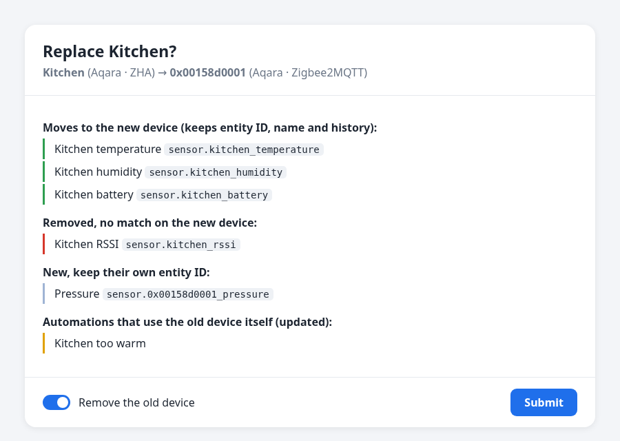

# Replace Device

**A sensor died? Pair the new one – it takes over the old one's name, entity IDs and history. Your automations and dashboards keep working.**

[English](#english) · [Dansk](#dansk)

## English

When a device breaks and you buy a new one, Home Assistant sees a stranger: new entity IDs, no history, and every automation, script and dashboard still points at the dead one. Replace Device moves everything over in one go.

### What moves over

| | |
| --- | --- |
| **Entity IDs** | The new entities get the old IDs, so automations, scripts, scenes, dashboards and templates keep working. |
| **History and statistics** | Graphs and long-term statistics continue. Energy totals too – a new meter starting at 0 kWh is handled as a reset. |
| **Your settings** | Names, icons, areas, labels, categories, voice aliases, display precision and unit settings. |
| **The device** | The new device gets the old one's name and area. |
| **Device triggers and actions** | Automations and scripts that point at the old device by ID are updated. |

A note is added to the logbook, and if the new device sends no values after 10 minutes, you get a repair.

### It notices by itself

Pair a new device of the same make and model while an old one has been dead for an hour, and a repair shows up: **"New Aqara WSDCGQ11LM found – replace Kitchen?"**. Tap **Fix**, check the preview, done.

### Use it for

- A dead sensor replaced with a new one
- Another brand doing the same job (an IKEA bulb instead of a Hue one)
- **Moving from ZHA to Zigbee2MQTT** (or back), one device at a time
- A re-flashed ESPHome device with a new name

### Installation

1. **HACS** → ⋮ → **Custom repositories** → `https://github.com/Clahen86/ha-replace-device`, type **Integration** → **Add**.
2. Search for **Replace Device** → **Download**, and restart Home Assistant.
3. **Settings → Devices & services → Add integration → Replace Device → Submit.**

### How to replace a device

1. Pair the new device as you normally would.
2. **Settings → Devices & services → Replace Device → Replace a device.**
3. Pick the old and the new device.
4. Check the pairs: each old entity has the matching new one picked (temperature to temperature, battery to battery). Change one if it's wrong, or pick — to drop it.
5. Read the preview – what moves, what's removed, which automations use the old device – and tap **Submit**.

### Good to know

- The old device is removed, so its names are free. If its integration doesn't allow that (a device that is still connected), you're told to remove it there.
- If the old device is still in your Zigbee network, remove it there too, so it doesn't come back.
- Device triggers from another integration (ZHA → Zigbee2MQTT) can have different trigger types. The preview lists those automations so you can check them.
- Only `automations.yaml` and `scripts.yaml` (the files the editors write) are updated. YAML you wrote yourself in other files keeps working through the entity IDs, but device IDs there are not changed.
- Everything is local. Nothing leaves your Home Assistant.

## Dansk

Når en enhed går i stykker, og du køber en ny, ser Home Assistant en fremmed. Den får nye entity-id'er og ingen historik, og alle automatiseringer, scripts og dashboards peger stadig på den døde. Udskift enhed flytter det hele over i ét hug.

### Det flyttes over

- **Entity-id'er:** De nye entiteter får de gamle id'er, så automatiseringer, scripts, scener, dashboards og skabeloner virker videre.
- **Historik og statistik:** Grafer og langtidsstatistik fortsætter. Det gælder også energi. En ny måler, der starter på 0 kWh, bliver regnet som en nulstilling.
- **Dine indstillinger:** Navne, ikoner, områder, etiketter, kategorier, stemme-aliasser, antal decimaler og enheder.
- **Enheden:** Den nye enhed får den gamles navn og område.
- **Enhedstriggere og -handlinger:** Automatiseringer og scripts, der peger på den gamle enhed via id, bliver opdateret.

Der kommer en note i logbogen. Sender den nye enhed ingen værdier efter 10 minutter, får du en reparation.

### Den opdager det selv

Parrer du en ny enhed af samme mærke og model, mens en gammel har været død i en time, kommer der en reparation: **"Ny Aqara WSDCGQ11LM fundet – skal den erstatte Køkken?"**. Tryk **Ret**, se forhåndsvisningen, og så er det klaret.

### Installation

1. **HACS** → ⋮ → **Brugerdefinerede repositories** → `https://github.com/Clahen86/ha-replace-device`, type **Integration** → **Tilføj**.
2. Søg efter **Replace Device** → **Download**, og genstart Home Assistant.
3. **Indstillinger → Enheder og tjenester → Tilføj integration → Udskift enhed → Send.**

### Sådan udskifter du en enhed

1. Par den nye enhed, som du plejer.
2. **Indstillinger → Enheder og tjenester → Udskift enhed → Udskift en enhed.**
3. Vælg den gamle og den nye enhed.
4. Tjek parrene: For hver gammel entitet er den matchende nye valgt, fx temperatur til temperatur og batteri til batteri. Ret den, hvis den er forkert, eller vælg — for at droppe den.
5. Læs forhåndsvisningen, der viser, hvad der flyttes, hvad der fjernes, og hvilke automatiseringer der bruger den gamle enhed. Tryk så **Send**.

### Godt at vide

- Den gamle enhed bliver fjernet, så dens navne bliver ledige. Tillader dens integration ikke det, fx fordi enheden stadig er forbundet, får du besked om at fjerne den der.
- Er den gamle enhed stadig i dit Zigbee-netværk, så fjern den også der, så den ikke kommer igen.
- Enhedstriggere fra en anden integration (ZHA → Zigbee2MQTT) kan have andre triggertyper. Forhåndsvisningen viser de automatiseringer, så du kan tjekke dem.
- Kun `automations.yaml` og `scripts.yaml`, som editorerne skriver, bliver opdateret. YAML, du selv har skrevet i andre filer, virker videre via entity-id'erne, men device-id'er dér bliver ikke ændret.
- Alt foregår lokalt. Intet forlader din Home Assistant.

## License

MIT
